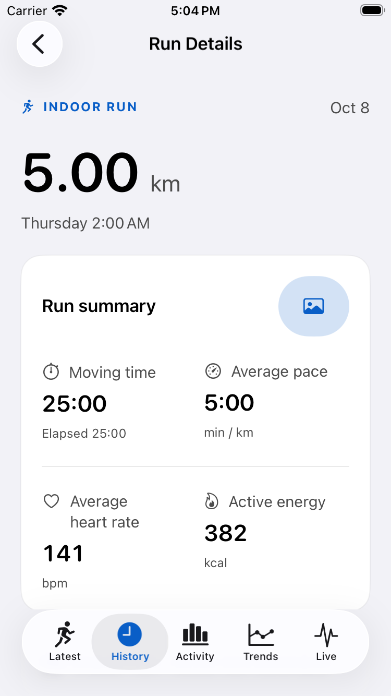
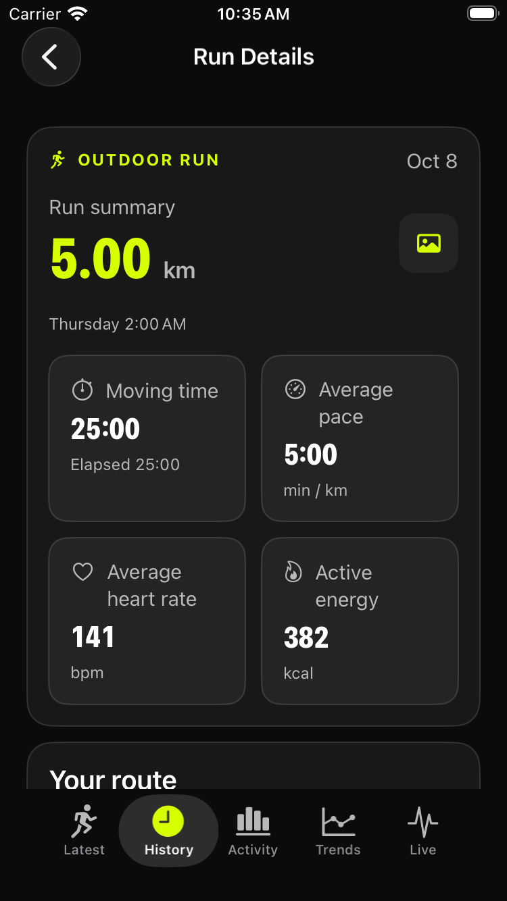
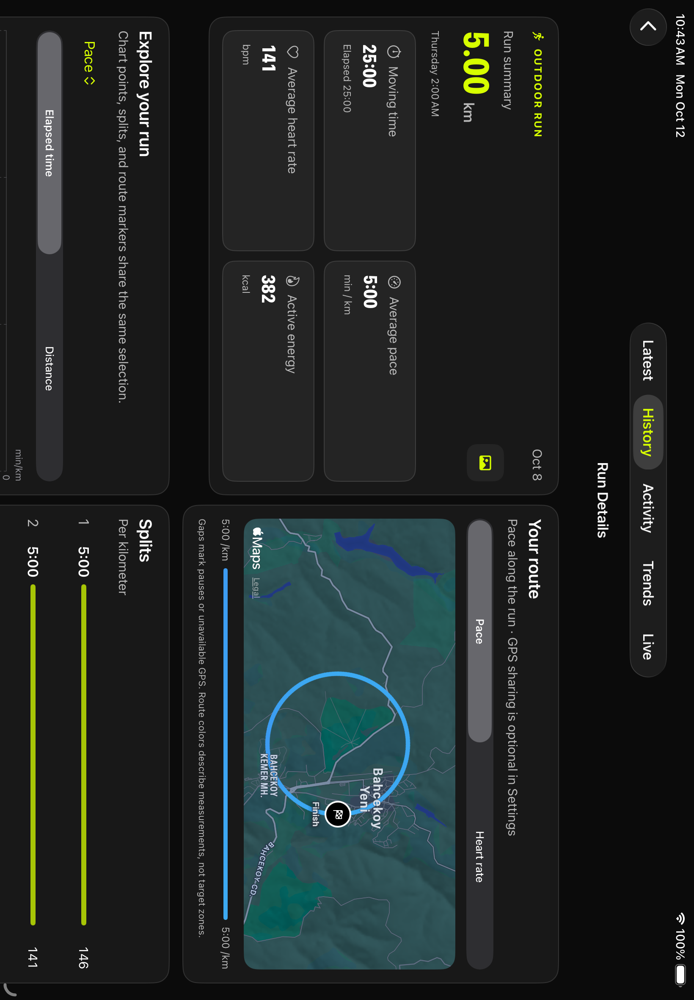

# Yellow dashboard redesign

Runner's iPhone/iPad interface uses a fixed dark palette: `#0B0B0B` background, `#181818` cards, `#242424` metric tiles, white primary text, `#B8B8B8` supporting text, and `#D7FF00` highlights. Primary actions use black text on yellow. Native tab bars explicitly retain dark appearance across tab changes and navigation.

Metric tiles use two columns on compact screens, four at 720 points of available width, and one at accessibility text sizes. Related dashboard sections use two columns from 840 points. The grid measures its container rather than assuming a device size, and content stops growing at 1200 points.

Latest and historical runs share the compact summary. History leads with the run journal; the density map follows the matching runs. Activity and Trends group related measurements into cards. The photo editor adopts the theme while preserving exported statistics, route colors, wordmark, and layer behavior.

The iOS app icon and optional photo sticker share the yellow runner on black. See [artwork provenance](../branding.md). The Watch interface, analytics, storage, and backend are unchanged.

## Photo export evidence

These synthetic exports come from `testIconExportAndAppearanceDoNotChangeOtherLayers`. Square, portrait, story, and original formats were inspected for unclipped statistics, wordmark, and icon placement. The red/blue background is deliberately generated test imagery.

- [Square](photo-square.jpg)
- [Portrait](photo-portrait.jpg)
- [Story](photo-story.jpg)
- [Original](photo-original.jpg)

## iPhone screenshots

Before and after Run Details, using synthetic workout fixtures:

 

- [Latest](iphone-latest.png)
- [Activity](iphone-activity.png)
- [History](iphone-history.png)
- [Trends](iphone-trends.png)
- [Live](iphone-live.png)
- [Accessibility text size](iphone-large-text.png)
- [Photo editor at accessibility text size in landscape](photo-editor-large-text-landscape.png)

The dark native tab-bar backdrop and fixed icon colors preserve contrast over bright charts without reducing the scrollable content area.

## iPad screenshots

Landscape places the run summary and route side by side:

- [Portrait Latest with four metric columns](ipad-latest.png)
- [Activity](ipad-activity.png)
- [History](ipad-history.png)
- [Trends](ipad-trends.png)
- [Live](ipad-live.png)
- [Accessibility text size in landscape](ipad-large-text-landscape.png)
- [Photo editor at accessibility text size in landscape](ipad-photo-large-text-landscape.png)

See [validation notes](../validation.md) for recorded test counts and the remaining manual device checks.
